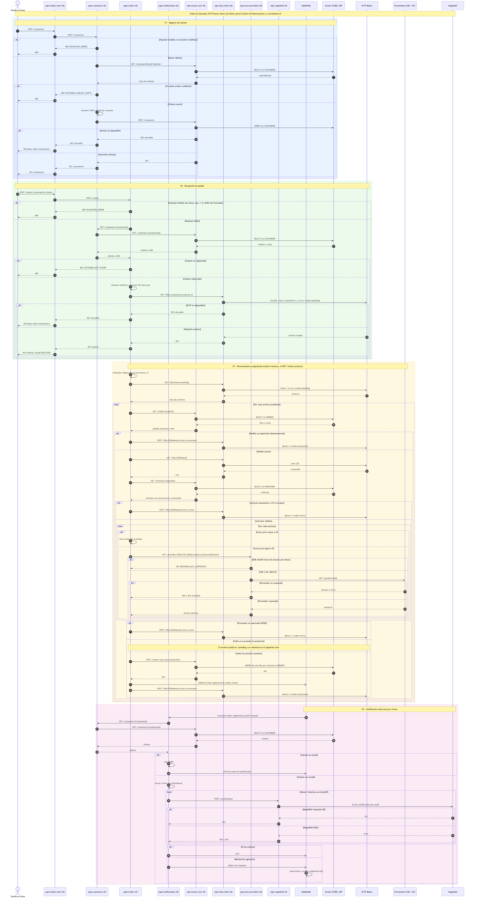

# Plan: Simulación Proyecto TIH MuleSoft (tienda en línea)

> Estado: **planificación aprobada, sin implementación.**
> Fuentes: *Requerimiento simulación proyecto mulesoft 2026.docx* y *Estándares de Desarrollo MuleSoft v1.1* (MADO).

## Archivos de este paquete

| Archivo | Contenido |
|---|---|
| `docs/PLAN-tih-mulesoft.md` | Este documento |
| `docs/diagrams/api-led-tih.drawio` | Diagrama API-led connectivity (abrir en app.diagrams.net) |
| `docs/diagrams/sequence-tih-completo.mmd` | Diagrama de secuencia completo (fuente Mermaid) |
| `docs/diagrams/sequence-tih-completo.svg` / `.png` | Diagrama de secuencia renderizado |
| `infra/` | Infraestructura de la Fase 0 (ver `infra/README.md`) |
| `specs/` | Contratos RAML 1.0 de las 8 APIs y 2 fragments, validados (ver `specs/README.md`) |
| `docs/GUIA-runtime-onprem.md` | Cómo descargar, instalar y registrar el runtime on-premise |

---

## 1. Contexto

Una tienda en línea quiere sustituir procesos manuales por una solución de integración con MuleSoft. Cubre cuatro procesos:

1. **Registro de clientes** en la BD core (Oracle).
2. **Recepción de pedidos** vía servicio. El pedido se deposita como CSV en SFTP y se devuelve el `orderId`.
3. **Procesamiento periódico** (configurable) de los CSV, sin duplicar pedidos. Los precios salen de la BD local (inventario) o de 3 proveedores: Fakestore REST, Escuelajs REST y Borland SOAP. El pedido se registra en Oracle.
4. **Notificación asíncrona por correo** vía RabbitMQ y MagicBell, cuando el pedido queda registrado.

La solución sigue **API-led connectivity** y el estándar MADO v1.1: naming, estructura de proyecto, handlers, DataWeave, loggers, MUnit ≥ 80 %. Se despliega en un **runtime on-premise** gestionado desde Anypoint Platform (training) y se asegura con **Client ID Enforcement**.

### Decisiones confirmadas

| Tema | Decisión |
|---|---|
| Naming de apps | `[x\|p\|s]api-<objetivo>-tih` (sin `-mado`) |
| Granularidad | 7 apps (1 XAPI, 3 PAPI, 3 SAPI). `sapi-magicbell-tih` se fusionó en papi-notifications (2026-10-12) |
| Especificaciones | RAML 1.0 en Design Center, con fragments compartidos en Exchange |
| Observabilidad | `x-correlation-id` propagado + log4j2 estandarizado (OpenTelemetry/New Relic fuera de alcance) |
| Borland SOAP (Provider-C) | **Implementado el 2026-10-14** contra un mock de SoapUI (el servicio real no responde): `sapi-price-providers` lo consulta por SOAP con el Web Service Consumer |
| Base de datos Oracle | **No se altera nada**: sin DDL, sin restricciones nuevas, sin datos de prueba. Solo se leen y escriben los datos de negocio que generen las APIs |
| MagicBell | Cuenta creada. **Decisión 2026-10-12:** se elimina `sapi-magicbell-tih`; `papi-notifications-tih` llama directo a `POST https://api.magicbell.com/broadcasts` con token Bearer (Project Auth) |
| Runtime y Oracle | El runtime corre en esta misma máquina, así que Oracle se alcanza por `localhost:1521` (el túnel ngrok no se usa) |

### Hallazgos del entorno (revisados el 2026-10-07, solo lectura)

**Oracle (contenedor `oracle-store`)**
- Oracle AI Database 26ai Free 23.26 en el PDB `FREEPDB1`, puerto 1521 expuesto. Hay un túnel ngrok TCP activo hacia `oracle-store:1521`.
- El esquema **`STORE_APP` ya existe** con `CUSTOMERS`, `INVENTORY` y `ORDERS`, con datos: 54 clientes, 20 artículos y 104 filas de pedidos.
- Las columnas coinciden con los anexos del requerimiento. UUID como `VARCHAR2(36)`, fechas como `TIMESTAMP`.
- Restricciones existentes:
  - `CUSTOMERS`: PK, **único solo en email** (`UQ_CUSTOMERS_EMAIL`) y `CHK_CUSTOMER_CONTACT` (email o teléfono).
  - `INVENTORY`: PK y `stock_qty >= 0`.
  - `ORDERS`: FK a clientes y a inventario. **No tiene PK ni único**.
- `STORE_APP` tiene los roles `CONNECT` y `RESOURCE`. Hay un usuario más, `PDBADMIN`.

**Seed de inventario**
- 5 artículos con precio local (250 a 5800).
- 15 artículos con `local_price = 0` y estas claves de proveedor: **`FAK`** (external_id 1-5), **`ESC`** (26-30) y **`BOR`** (1-5).

**Proveedores de precios**
- Fakestore ids 1-5: responden (precios 15.99 a 695).
- Escuelajs ids 26-30: responden (precios 16 a 66).
- Borland SOAP: el WSDL no responde (timeout por HTTP y HTTPS; el DNS resuelve pero se rechaza la conexión). Sigue sin validar.

**Máquina local**
- Java 17.0.12, Maven 3.9, Docker 29.5, Git y `anypoint-cli-v4` instalados. No hay `newman`.
- **Anypoint Studio** en `C:\AnypointStudio` con **Mule EE 4.11 embebido**. No hay un runtime standalone on-premise instalado.
- El puerto **8081 ya está ocupado** por otro proceso. Por eso el plan mueve la XAPI a 8080 (ver §5).
- RabbitMQ y Rebex SFTP no existían; se crearon en la Fase 0 (ver §8).

### Supuestos

- Desarrollo con **Mule EE 4.11 (embebido en Studio) + Java 17**. El runtime standalone on-premise se descarga en la Fase 6 y debe ser de la misma versión.
- El `item` del CSV es el **id interno (UUID) del inventario**. Si `local_price = 0`, se resuelve con `external_id` + `provider_abv`.
- Claves de proveedor: **`FAK`** = Fakestore (Provider-A), **`ESC`** = Escuelajs (Provider-B), **`BOR`** = Borland (Provider-C). Son las que ya tiene la BD.
> **Actualización 2026-10-14:** `BOR` (Borland SOAP) ya está implementado en `sapi-price-providers-tih` contra un mock de SoapUI (`apps/sapi-price-providers-tih/borland-mock/`); el servicio real sigue caído. Donde este documento dice que `BOR` responde 501 o está fuera de alcance, describe el estado anterior.
- **`BOR` está fuera de alcance.** `sapi-price-providers` responde `501 PROVIDER_NOT_SUPPORTED` y `papi-orders` lo trata como error de negocio no reintentable: el CSV se mueve a `/orders/error`. Los 5 artículos `BOR` del seed quedan sin poder cotizarse hasta retomar Borland.
- Un cliente es **duplicado** si ya existe su email **o** su teléfono (se responde 409). La BD solo garantiza unicidad del email, así que el teléfono se valida en la SAPI.
- **No** se descuenta `stock_qty` (no lo pide el requerimiento). Queda como mejora opcional.
- Si el cliente no tiene email, la notificación se omite con log `WARN` y se hace ACK del mensaje.
- Artefactos internos en **inglés** (lo exige el estándar). La documentación va en español.

---

## 2. Casos de uso

| ID | Caso de uso | Actor | Resultado esperado |
|---|---|---|---|
| CU-01 | Registrar cliente válido | Tienda (consumidor) | 201 + `customerId` |
| CU-02 | Registrar cliente sin email ni teléfono | Tienda | 400 `VALIDATION_ERROR` |
| CU-03 | Registrar cliente duplicado (email/teléfono) | Tienda | 409 `CUSTOMER_ALREADY_EXISTS` |
| CU-04 | Registrar cliente con la BD caída | Tienda | 503 `retryable: true` + `Retry-After` |
| CU-05 | Crear pedido de cliente registrado | Tienda | 201 + `orderId`; el CSV queda en `/orders/pending` |
| CU-06 | Crear pedido de cliente inexistente | Tienda | 404 `CUSTOMER_NOT_FOUND` |
| CU-07 | Crear pedido inválido (sin items, qty ≤ 0, UUID mal formado) | Tienda | 400 |
| CU-08 | Crear pedido con el SFTP caído | Tienda | 503 `retryable: true` |
| CU-09 | Procesar pedido con precios locales | Scheduler | Filas en ORDERS, evento publicado, CSV en `/processed` |
| CU-10 | Procesar pedido con precios de proveedores FAK y ESC | Scheduler | Precio obtenido del proveedor correcto |
| CU-11 | Evitar reprocesar un pedido ya registrado | Scheduler | No hay inserción duplicada; el CSV se mueve a `/processed` |
| CU-12 | Pedido con artículo inexistente o CSV corrupto | Scheduler | CSV en `/orders/error` + log de error |
| CU-13 | Proveedor de precios no disponible | Scheduler | El CSV queda en `/pending` y se reintenta en el siguiente ciclo |
| CU-14 | Notificar por correo un pedido registrado | Broker / papi-notifications | Correo enviado vía MagicBell; mensaje con ACK |
| CU-15 | MagicBell falla de forma persistente | Broker | Reintentos con backoff; luego el mensaje pasa a DLQ |
| CU-16 | Llamada sin `client_id`/`client_secret` | Cualquiera | 401 (política de API Manager) |
| CU-17 | Disparar manualmente el procesamiento (demo) | Operador | `POST /orders/process` → 202 |
| CU-18 | Pedido con artículo de proveedor BOR | Scheduler | Se cotiza con el servicio SOAP de Borland (mock de SoapUI en local); si Borland no conoce el artículo, 404 `PRODUCT_NOT_FOUND` y el CSV va a `/orders/error` |

---

## 3. Diagrama de secuencia completo (Mermaid)

Un solo diagrama cubre los 4 procesos (P1 registro, P2 recepción de pedido, P3 procesamiento programado y P4 notificación), con sus ramas de error.
- Fuente: `docs/diagrams/sequence-tih-completo.mmd`.
- Renderizado: `docs/diagrams/sequence-tih-completo.svg` (vectorial) y `.png` (3647 × 6899 px).

```mermaid
sequenceDiagram
    autonumber
    actor T as Tienda en línea
    participant X as xapi-online-store-tih
    participant PC as papi-customers-tih
    participant PO as papi-orders-tih
    participant PN as papi-notifications-tih
    participant SO as sapi-oracle-core-tih
    participant SS as sapi-sftp-orders-tih
    participant SP as sapi-price-providers-tih
    participant SM as sapi-magicbell-tih
    participant MQ as RabbitMQ
    participant DB as Oracle STORE_APP
    participant FS as SFTP Rebex
    participant PV as Proveedores FAK / ESC
    participant MB as MagicBell

    Note over T,MB: Todas las llamadas HTTP llevan client_id/client_secret (Client ID Enforcement) y x-correlation-id

    rect rgb(232, 243, 255)
    Note over T,DB: P1 - Registro de cliente
    T->>X: POST /customers
    X->>PC: POST /customers
    alt Payload inválido o sin email ni teléfono
        PC-->>X: 400 VALIDATION_ERROR
        X-->>T: 400
    else Datos válidos
        PC->>SO: GET /customers?email=&phone=
        SO->>DB: SELECT en CUSTOMERS
        DB-->>SO: coincidencias
        SO-->>PC: lista de clientes
        alt Ya existe email o teléfono
            PC-->>X: 409 CUSTOMER_ALREADY_EXISTS
            X-->>T: 409
        else Cliente nuevo
            PC->>PC: Generar UUID y fecha de creación
            PC->>SO: POST /customers
            SO->>DB: INSERT en CUSTOMERS
            alt Oracle no disponible
                SO-->>PC: 503 retryable
                PC-->>X: 503 retryable
                X-->>T: 503 Retry-After (reintentar)
            else Inserción exitosa
                SO-->>PC: 201
                PC-->>X: 201 customerId
                X-->>T: 201 customerId
            end
        end
    end
    end

    rect rgb(235, 250, 235)
    Note over T,FS: P2 - Recepción de pedido
    T->>X: POST /orders (customerId e items)
    X->>PO: POST /orders
    alt Payload inválido (sin items, qty <= 0, UUID mal formado)
        PO-->>X: 400 VALIDATION_ERROR
        X-->>T: 400
    else Payload válido
        PO->>PC: GET /customers/{customerId}
        PC->>SO: GET /customers/{customerId}
        SO->>DB: SELECT en CUSTOMERS
        DB-->>SO: cliente o vacío
        SO-->>PC: cliente o 404
        PC-->>PO: cliente o 404
        alt Cliente no registrado
            PO-->>X: 404 CUSTOMER_NOT_FOUND
            X-->>T: 404
        else Cliente registrado
            PO->>PO: Generar orderId y construir CSV item,qty
            PO->>SS: PUT /files/customerId_orderId.csv
            SS->>FS: Escribir .tmp y renombrar a .csv en /orders/pending
            alt SFTP no disponible
                SS-->>PO: 503 retryable
                PO-->>X: 503 retryable
                X-->>T: 503 Retry-After (reintentar)
            else Depósito exitoso
                FS-->>SS: archivo creado
                SS-->>PO: 201
                PO-->>X: 201 orderId
                X-->>T: 201 orderId, estado RECEIVED
            end
        end
    end
    end

    rect rgb(255, 248, 225)
    Note over PO,PV: P3 - Procesamiento programado (cada N minutos, o POST /orders/process)
    PO->>PO: Scheduler dispara (maxConcurrency 1)
    PO->>SS: GET /files?status=pending
    SS->>FS: Listar *.csv en /orders/pending
    FS-->>SS: archivos
    SS-->>PO: lista de archivos
    loop Por cada archivo pendiente
        PO->>SO: GET /orders/{orderId}
        SO->>DB: SELECT en ORDERS
        DB-->>SO: filas o vacío
        SO-->>PO: pedido existente o 404
        alt Pedido ya registrado (idempotencia)
            PO->>SS: POST /files/{fileName}/move a processed
            SS->>FS: Mover a /orders/processed
        else Pedido nuevo
            PO->>SS: GET /files/{fileName}
            SS->>FS: Leer CSV
            FS-->>SS: contenido
            SS-->>PO: CSV
            PO->>SO: GET /inventory/items?ids=
            SO->>DB: SELECT en INVENTORY
            DB-->>SO: artículos
            SO-->>PO: artículos con precio local y proveedor
            alt Artículo inexistente o CSV corrupto
                PO->>SS: POST /files/{fileName}/move a error
                SS->>FS: Mover a /orders/error
            else Artículos válidos
                loop Por cada artículo
                    alt local_price mayor a 0
                        PO->>PO: Usar precio de la tienda
                    else local_price igual a 0
                        PO->>SP: GET /providers/{FAK|ESC|BOR}/products/{externalId}/price
                        alt BOR (SOAP) fuera de alcance por ahora
                            SP-->>PO: 501 PROVIDER_NOT_SUPPORTED
                        else FAK o ESC (REST)
                            SP->>PV: GET /products/{id}
                            alt Proveedor no responde
                                PV--xSP: timeout o error
                                SP-->>PO: 502 o 503 retryable
                            else Proveedor responde
                                PV-->>SP: producto
                                SP-->>PO: precio canónico
                            end
                        end
                    end
                end
                alt Proveedor no soportado (BOR)
                    PO->>SS: POST /files/{fileName}/move a error
                    SS->>FS: Mover a /orders/error
                else Falló un proveedor (transitorio)
                    Note over PO,FS: El archivo queda en /pending y se reintenta en el siguiente ciclo
                else Todos los precios resueltos
                    PO->>SO: POST /orders (una sola transacción)
                    SO->>DB: INSERT de una fila por artículo en ORDERS
                    DB-->>SO: OK
                    SO-->>PO: 201
                    PO-)MQ: Publicar order.registered en orders.events
                    PO->>SS: POST /files/{fileName}/move a processed
                    SS->>FS: Mover a /orders/processed
                end
            end
        end
    end
    end

    rect rgb(250, 235, 245)
    Note over MQ,MB: P4 - Notificación asíncrona por correo
    MQ-)PN: Consume orders.registered.q (ACK manual)
    PN->>PC: GET /customers/{customerId}
    PC->>SO: GET /customers/{customerId}
    SO->>DB: SELECT en CUSTOMERS
    DB-->>SO: cliente
    SO-->>PC: cliente
    PC-->>PN: cliente
    alt Cliente sin email
        PN->>PN: Log WARN
        PN-)MQ: ACK (se omite la notificación)
    else Cliente con email
        PN->>PN: Armar correo con DataWeave
        loop Hasta 3 intentos con backoff
            PN->>SM: POST /notifications
            SM->>MB: Enviar notificación por email
            alt MagicBell responde OK
                MB-->>SM: 2xx
                SM-->>PN: 201
            else MagicBell falla
                MB--xSM: error
                SM-->>PN: 502 o 503
            end
        end
        alt Envío exitoso
            PN-)MQ: ACK
        else Reintentos agotados
            PN-)MQ: Reject sin requeue
            MQ->>MQ: Dead-letter a orders.registered.dlq
        end
    end
    end
```





**Reglas clave que muestra el diagrama**
- La política de API Manager valida el Client ID antes de llegar a cada API. APIkit valida el esquema RAML.
- La regla "email **o** teléfono" no se puede expresar en RAML, así que la valida papi-customers. Oracle la refuerza con `CHK_CUSTOMER_CONTACT`.
- Las fallas técnicas devuelven 503 con `retryable: true`, para que el consumidor sepa que puede reintentar (P1 y P2).
- El CSV se llama `<customerId>_<orderId>.csv`. Se escribe primero como `.tmp` y luego se renombra, para que el scheduler nunca lea un archivo a medio escribir.
- La frecuencia del scheduler sale de una propiedad (`scheduler.orders.frequency`) y el flujo tiene `maxConcurrency="1"`, así que dos ciclos nunca se traslapan.
- **Anti-duplicidad en capas:**
  1. El CSV se mueve a `/processed` al terminar.
  2. Antes de procesar se revisa un Object Store persistente con los `orderId` ya procesados.
  3. Se consulta `GET /orders/{orderId}` en la BD.
  4. No se agrega ninguna restricción en la BD (decisión: Oracle no se altera). La concurrencia se evita con `maxConcurrency=1` y con la inserción transaccional.
- La decisión de precio se evalúa **por artículo**. La inserción de todos los artículos del pedido es **una sola transacción**.
- Las fallas de negocio (artículo inexistente, CSV corrupto) mueven el archivo a `/error`. Las fallas transitorias (proveedor o BD caídos) lo dejan en `/pending` para el siguiente ciclo.
- El listener AMQP usa `ackMode=MANUAL`. Los reintentos usan `until-successful` (3 intentos, backoff). Si se agotan, el mensaje se rechaza sin requeue y el *dead-letter exchange* lo manda a `orders.registered.dlq`.
- `papi-notifications` reutiliza `papi-customers GET /customers/{id}` para obtener el correo.

---

## 4. Diagrama API-led connectivity (draw.io)

Archivo: [`docs/diagrams/api-led-tih.drawio`](diagrams/api-led-tih.drawio). Se abre con app.diagrams.net (*File → Open from → Device*) o con la extensión de draw.io en VS Code.

Capas del diagrama:
- **Consumidores**: tienda en línea (Postman).
- **Experience**: `xapi-online-store-tih`.
- **Process**: `papi-customers-tih`, `papi-orders-tih` (con scheduler), `papi-notifications-tih`, más RabbitMQ.
- **System**: `sapi-oracle-core-tih`, `sapi-sftp-orders-tih`, `sapi-price-providers-tih`. (`sapi-magicbell-tih` se fusionó en papi-notifications el 2026-10-12.)
- **Backends**: Oracle, SFTP, Fakestore, Escuelajs, Borland y MagicBell.

Las flechas continuas son llamadas síncronas. Las punteadas naranjas son el flujo asíncrono por RabbitMQ.

> El diagrama muestra la XAPI en el puerto 8081. Ese puerto está ocupado en tu máquina (§1); al implementar se usará 8080 y se actualizará el diagrama.

---

## 5. Capacidades por API

| App/API | Capacidad | Proceso | Path base | Método | Path recurso |
|---|---|---|---|---|---|
| xapi-online-store-tih | Registrar cliente | P1 | /api/v1/online-store | POST | /customers |
| xapi-online-store-tih | Crear pedido | P2 | /api/v1/online-store | POST | /orders |
| papi-customers-tih | Registrar cliente (reglas de negocio, duplicados) | P1 | /api/v1/customers-management | POST | /customers |
| papi-customers-tih | Consultar cliente | P2, P4 | /api/v1/customers-management | GET | /customers/{customerId} |
| papi-orders-tih | Recibir pedido (valida cliente, genera orderId, deposita CSV) | P2 | /api/v1/orders-management | POST | /orders |
| papi-orders-tih | Procesar pedidos pendientes (trigger manual) | P3 | /api/v1/orders-management | POST | /orders/process |
| papi-orders-tih | Procesar pedidos pendientes (scheduler interno) | P3 | — | Scheduler | — |
| papi-notifications-tih | Notificar pedido registrado (listener AMQP `orders.registered.q`) | P4 | — | AMQP | — |
| papi-notifications-tih | Notificar pedido registrado (reenvío manual) | P4 | /api/v1/notifications | POST | /orders-registered |
| sapi-oracle-core-tih | Crear cliente | P1 | /api/v1/core/store | POST | /customers |
| sapi-oracle-core-tih | Buscar clientes por email/teléfono | P1 | /api/v1/core/store | GET | /customers?email=&phone= |
| sapi-oracle-core-tih | Consultar cliente por id | P2, P4 | /api/v1/core/store | GET | /customers/{customerId} |
| sapi-oracle-core-tih | Consultar artículos por ids (lote) | P3 | /api/v1/core/store | GET | /inventory/items?ids= |
| sapi-oracle-core-tih | Registrar pedido (transaccional, bulk) | P3 | /api/v1/core/store | POST | /orders |
| sapi-oracle-core-tih | Consultar pedido (idempotencia) | P3 | /api/v1/core/store | GET | /orders/{orderId} |
| sapi-sftp-orders-tih | Depositar archivo de pedido | P2 | /api/v1/sftp/orders | PUT | /files/{fileName} |
| sapi-sftp-orders-tih | Listar archivos pendientes | P3 | /api/v1/sftp/orders | GET | /files?status=pending |
| sapi-sftp-orders-tih | Leer archivo | P3 | /api/v1/sftp/orders | GET | /files/{fileName} |
| sapi-sftp-orders-tih | Mover archivo (processed/error) | P3 | /api/v1/sftp/orders | POST | /files/{fileName}/move |
| sapi-price-providers-tih | Consultar precio por proveedor (canónico) | P3 | /api/v1/price-providers | GET | /providers/{providerAbv}/products/{externalId}/price |

**Proveedores soportados:** `FAK`, `ESC` y `BOR` (Borland por SOAP 1.1; en local lo atiende un mock de SoapUI).

**Puertos propuestos en el runtime on-prem:** xapi 8080, papi-customers 8082, papi-orders 8083, papi-notifications 8084, sapis 8091-8093.

**Responsabilidad de cada capa**
- **XAPI**: contrato del canal tienda y punto de aplicación de políticas. Solo hace `flow-ref` hacia la implementación, mapeo mínimo y respuestas de error amigables.
- **PAPI**: reglas de negocio y orquestación.
  - papi-customers: regla email/teléfono, duplicados, UUID.
  - papi-orders: validación del cliente, CSV, scheduler, resolución de precio por `provider_abv`, idempotencia, publicación del evento.
  - papi-notifications: consumo del evento, enriquecimiento, armado del correo y envío directo a MagicBell.
- **SAPI**: acceso a un solo sistema, con modelo canónico y sin reglas de negocio.
  - sapi-price-providers traduce Fakestore, Escuelajs y Borland a `{externalId, providerAbv, price, currency, name}`.
  - (MagicBell ya no tiene SAPI: papi-notifications lo llama directo y guarda el token en secure properties.)

**Contratos transversales** (fragments RAML en Exchange)
- `tih-common-library`: tipos `Customer`, `OrderRequest`, `OrderReceived`, `Price` y `ErrorResponse`.
- `tih-common-traits`: header `x-correlation-id`, trait `client-id-required` y respuestas de error estándar.
- Modelo de error:
  ```json
  { "code": "CUSTOMER_NOT_FOUND", "message": "...", "correlationId": "...", "timestamp": "...", "retryable": false }
  ```
- Mapeo HTTP:
  - 400 validación; 401 sin credenciales (política); 404 no existe; 409 duplicado.
  - 502 error del proveedor; 503 backend no disponible (`retryable: true` + `Retry-After`); 500 inesperado.
- Entre capas se usa `error-mapping` (por ejemplo `HTTP:NOT_FOUND → CUSTOMERS:NOT_FOUND`), así los errores se propagan con semántica.

**Evento RabbitMQ**
- Exchange `orders.events` (topic), routing key `order.registered`, cola `orders.registered.q`.
- DLX `orders.events.dlx` → `orders.registered.dlq`.
- Payload: `{eventType, orderId, customerId, items[{itemId, qty, price}], total, createdAt}`. El header `correlationId` viaja como propiedad AMQP.

---

## 6. Modelo de datos (Oracle, ya existente)

Esquema **`STORE_APP`** en `FREEPDB1`. Las tablas ya existen y coinciden con los anexos del requerimiento, así que **no se crean desde cero**.

| Tabla | Estado actual | Cambios |
|---|---|---|
| `CUSTOMERS` | PK `id`, único en `client_email`, `CHECK` email o teléfono | Ninguno. El teléfono se valida en la SAPI. |
| `INVENTORY` | PK `id`, `CHECK stock_qty >= 0`, seed de 20 artículos | Ninguno. |
| `ORDERS` | FK a clientes y a inventario. **Sin PK ni único.** 104 filas | Ninguno. La idempotencia se resuelve en la aplicación. |

Notas:
- Una fila de ORDERS representa un artículo del pedido, por lo que `id` por sí solo no es único.
- Un pedido con el mismo artículo repetido en el CSV se consolida sumando `qty`, para no generar filas repetidas.
- **Esta base no se altera**: sin DDL, sin restricciones y sin datos de prueba. Las pruebas que escriban datos lo harán a través de las APIs.
- El usuario y la contraseña de aplicación ya los tiene el equipo. Se piden al llegar a la Fase 2 y se guardan cifrados (Secure Properties).
- El driver JDBC es `ojdbc11` y el servicio es `FREEPDB1`. El URL será `jdbc:oracle:thin:@//<host>:1521/FREEPDB1`.

---

## 7. Estándar aplicado a cada app (plantilla común)

```
<app>/
  src/main/mule/interface.xml              # scaffolding APIkit + listener config + autodiscovery (sin lógica)
  src/main/mule/common/global.xml          # configs de conectores, properties, secure-properties
  src/main/mule/common/common.xml          # subflows reutilizables (logging INIT/END, correlationId)
  src/main/mule/handlers/global-error-handlers.xml   # + http-/db-/sftp-handlers según aplique
  src/main/mule/implementations/*.xml      # p.ej. orchestrator-sync-pending-orders.xml, register-customer.xml
  src/main/resources/properties/{local,dev}-application-config.yaml
  src/main/resources/properties/{local,dev}-secure-application-config.yaml  # valores ![cifrados]
  src/main/resources/dataweave/mapping-*.dwl, functions-*.dwl
  src/main/resources/log4j2.xml            # patrón con correlationId, nivel INFO
  src/test/munit/<flujo>-test.xml
  src/test/resources/payloads/, configs/
```

- **Naming**
  - Flujos `<funcionalidad>-flow`, subflujos `-subflow`, en kebab-case y en inglés.
  - Componentes con `doc:name` descriptivo (`db-select-customer-by-id`, `transform-build-order-csv`).
  - Variables en camelCase.
  - Tests `<flujo>_<condición>_<resultado>`.
- **Configuración**
  - Toda la conexión en `global.xml` con `${}`; nada inline.
  - `env` y `mule.key` se pasan como argumentos del runtime.
  - `mule-artifact.json` declara `secureProperties`.
- **Seguridad**
  - Secure Properties con AES/CBC para passwords de Oracle y SFTP, credenciales de RabbitMQ, API key/secret de MagicBell y `client_id`/`client_secret` de las llamadas entre capas.
  - Autodiscovery con `api.id` por propiedad.
- **Resiliencia**
  - `reconnection` en conectores.
  - `until-successful` solo en operaciones idempotentes (GET, envío de notificación).
  - Timeouts por propiedad.
- **Logs**: loggers `INIT`/`END`/`ERROR` con `correlationId`. Siempre hay un logger dentro de cada `on-error`.
- **MUnit**: ≥ 80 % de cobertura, mocks de cada conector o request (`Mock Database`, `Mock http Request to sapi-...`), casos positivos, negativos y de error, patrón AAA.
- Durante la implementación se usan las skills del proyecto. Resultados al 2026-10-23:

| Skill | Para qué se usó | Resultado |
|---|---|---|
| `build-mule-integration` | Flujos, conectores y transformaciones de las 7 apps | 7 apps en `apps/` con APIkit, DB Oracle, SFTP, AMQP y Web Service Consumer (Borland). Build de las 7 con `BUILD SUCCESS` y MUnit en verde |
| `manage-global-configurations` | Validar y consolidar lo global | Sin referencias rotas ni elementos sin uso. Error handlers y `http:listener-config` movidos a `common/global.xml` en las 7 apps; carpeta `handlers/` eliminada. `apikit:config` se queda junto a su flujo |
| `secure-mule-app` | Cifrar credenciales | Secure Properties AES/CBC (secure-properties 1.3.2); valores en `*-secure-application-config.yaml`; la clave se pasa como `-M-Dencryption.key` en cada ejecución de Studio |
| `generate-doc-description` | Documentar `src/main/mule` | 16 `doc:description` en la primera pasada y 32 más con la corrección de `notify-order-registered.xml`, en las 7 apps |
| `generate-bat-tests` | Pruebas de caja negra contra las apps desplegadas | 82 pruebas en `apps/<app>/bat-generated/`; las 82 aprobadas (2026-10-23). Las 3 de Borland (BOR) requieren que el MockService `OrderServiceSoap` de SoapUI (8088) esté iniciado; sin él dan 502 |
| `author-governance-ruleset` | Convenciones de los RAML como reglas | `infra/governance/tih-raml-conventions.yaml`; los 7 RAML cumplen. No puede exigir el trait `secured` (el modelo de gobernanza no expone los traits). Se ejecuta en local con el CLI, sin Anypoint Platform |
| `manage-api-version` | Actualizar la versión del contrato en un proyecto que lo consume de Exchange | Probada en un proyecto aparte, `sapi-stores` (no en las 7 apps TIH): de 1.0.2 a 1.0.3, con `BUILD SUCCESS`. Requirió `~/.m2/settings.xml` con las credenciales de Exchange leídas de variables de entorno; la skill no lo pide, pero la compilación que ejecuta sí. El `apikit:config` guarda también la versión y hubo que alinearlo a mano |

  Cobertura MUnit por app: 100 % en `xapi-online-store`, `papi-customers`, `papi-orders`, `sapi-oracle-core`, `sapi-sftp-orders` y `sapi-price-providers`; 92,59 % en `papi-notifications`. BAT por app: `sapi-oracle-core` 21/21, `sapi-sftp-orders` 12/12, `xapi-online-store` 10/10, `papi-customers` 9/9, `papi-orders` 8/8, `papi-notifications` 6/6 y `sapi-price-providers` 16/16.

  Skills instaladas que no aplican hoy: `generate-connectivity-knowledge` (no hubo SaaS sin conector), `upgrade-mule-app` (ya están en Mule 4.11.4 y Java 17), `create-mule-run-config` y `update-mule-run-config` (son de Anypoint Code Builder; Studio usa sus propios `.launch`), `run-system-diagnostics` (pensada para ACB) y las de PDK (`develop-pdk-policy`, `pdk-prerequisites`, `pdk-templates`; requieren gateway y cuenta de Anypoint Platform). `manage-api-version` no aplica a las 7 apps porque sus RAML son locales y no hay APIs en Exchange como dependencias.

#### Limitaciones, archivos que generan y dependencias de cada skill

Salvo donde se indica, sale de la lectura del texto de cada skill (`.claude/skills/<skill>/SKILL.md`) y de lo observado al usarlas en este proyecto. «CLI» es `anypoint-cli-v4`; «plugin DX» es `@salesforce/anypoint-cli-dx-mule-plugin`.

| Skill | Limitaciones | Archivos que genera o modifica | Dependencias |
|---|---|---|---|
| `build-mule-integration` | Necesita acceso a Exchange para buscar conectores y leer su metadata. En proyectos existentes cada cambio termina con `mvn clean package`. No valida la lógica de negocio | Flujos XML en `src/main/mule/`, DataWeave en `src/main/resources/dataweave/`, `pom.xml` (conectores), `mule-artifact.json`, properties. Temporales en `tmp/` que borra al final | CLI con plugin DX, Java 11+, Maven 3.6+, Mule Runtime, sesión con acceso a Exchange |
| `generate-doc-description` | Solo escribe `doc:description` (máximo 150 caracteres); no toca `doc:name` ni la lógica. No comprueba que el texto sea correcto. Una escritura y una aprobación por archivo | Los XML existentes de `src/main/mule` (y los de MUnit si se pide) | Ninguna |
| `secure-mule-app` | La clave de cifrado se entrega en ejecución (`-M-Dencryption.key`) y no se guarda en el proyecto. Su paso de `.vscode/launch.json` no aplica a Studio: la VM arg se pone a mano en Run Configurations. Detecta valores sensibles por patrones de nombre | `*-secure-application-config.yaml` (o `.secure.properties`) con valores `![…]`, XML con `${secure::…}`, la config `secure-properties` global, la dependencia en `pom.xml`, entradas en `.gitignore` | Java, `secure-properties-tool.jar` (lo descarga de docs.mulesoft.com si falta), módulo `mule-secure-configuration-property-module` (1.3.2 aquí) |
| `manage-global-configurations` | Su convención es un solo `global-configs.xml`; aquí se adaptó a `common/global.xml`. `apikit:config` se queda junto a su flujo. Consolidar exige confirmación. Es muy conversacional (varias pausas) | `global-configs.xml` (o el archivo de configuración global), properties por ambiente, `pom.xml` | CLI con plugin DX y Exchange solo para crear configs de conector; Java 11+ y Maven para el build de validación |
| `generate-bat-tests` | La API debe estar desplegada y con sus dependencias arriba. Sin API Manager, la falta de credenciales da 400 y no 401. No cubre errores que exijan apagar servicios. Deja datos de prueba (sin limpieza). Ajusta las aserciones al comportamiento real, no juzga el negocio. No sustituye a MUnit | `<app>/bat-generated/`: `tests/*.dwl`, `bat.yaml`, `config/`, `run-bat.sh`, `reports/` y `REPORT.md`. Temporales en `tmp/bat-gen/` | BAT CLI (`~/.bat/bat`), `jq`, Java 17+ |
| `author-governance-ruleset` | Un ruleset apunta a un solo tipo de contrato (no mezcla `api-spec` y `mcp`). No ve los traits, así que no puede exigir `secured`. Aplicarlo en Anypoint requiere Platform. Para validar un RAML en local hay que darle una carpeta con `exchange.json` | Un YAML de reglas (`infra/governance/tih-raml-conventions.yaml`) | CLI con `mulesoft-anypoint-cli-governance-plugin` 1.0.20 o superior (la skill lo instala o actualiza con npm global en cada arranque) |
| `manage-api-version` | Solo cambia el número de versión de una dependencia de API: no publica contratos ni actualiza el `apikit:config`, que guarda también la versión y hay que alinearlo a mano. Su recompilación necesita credenciales de Maven para Exchange. Restaura el `pom.xml` si la compilación falla | `pom.xml` (propiedad `<artifactId>.version`) y `target/` por la recompilación | CLI con sesión y lectura de Exchange, `jq`, Maven 3.6+, `~/.m2/settings.xml` con credenciales de Exchange |
| `generate-connectivity-knowledge` | Valida contra la API real (efectos reales: datos creados, correos). Genera un contrato mínimo a propósito. Tiene cuatro pausas obligatorias. Depende de la documentación pública | `connectivity-schema/<api>/`: `action-plan.md`, `api-reference.md`, `<api>.yaml` (OpenAPI 3.0), `config.properties` | Acceso web (búsqueda y lectura de documentación), `curl`, credenciales del SaaS que pone el usuario. No lee ni muestra los valores |
| `upgrade-mule-app` | Requiere Mule 4.3 o posterior. Es muy larga y exige aprobar un plan. Puede dejar puntos «para atención del operador» (operaciones sin equivalente, DataWeave, Java a medida). Descarga JDKs | `pom.xml`, `mule-artifact.json`, flujos, DataWeave y MUnit según el plan; temporales en `tmp/` (plan en `tmp/upgrade-plan.md`) | CLI con plugin DX 1.3.0 o superior, Java 8+, Mule Runtime, Maven, acceso a Exchange para versiones de conectores |
| `create-mule-run-config` | Es de Anypoint Code Builder: guarda en `.vscode/launch.json` (un proyecto) o en el `.code-workspace` (varios). Delega en una herramienta del host. No aplica a Studio | `launch.json` o `.code-workspace` | Anypoint Code Builder (VS Code) |
| `update-mule-run-config` | Igual: edita nombre, proyectos o modo run/debug de una configuración de ACB que ya existe. No aplica a Studio | El mismo `launch.json` o `.code-workspace` | Anypoint Code Builder (VS Code) |
| `run-system-diagnostics` | Compara con mínimos de ACB (8 núcleos, 32 GB de RAM, NVMe, 50 GB libres, 1 Gbps), no con los de Studio. La prueba de IOPS descarga DiskSpd de GitHub, crea un archivo de 1 GB y escribe en disco 30 s por prueba. Los cambios de Defender y del plan de energía requieren administrador y tu confirmación | `assets/DiskSpd/` dentro de la carpeta de la skill (si descarga) y un `testfile.dat` temporal que borra | PowerShell (Windows), acceso a GitHub para DiskSpd, administrador para las optimizaciones |
| `develop-pdk-policy` | Es para Flex/Omni Gateway, no para un runtime de Mule. Publicar exige una Connected App con Exchange Contributor, y el playground local necesita un `registration.yaml` generado en Runtime Manager. Las releases son inmutables | Un proyecto de política: `Cargo.toml`, `src/lib.rs`, `gcl.yaml`, `Makefile`, `playground/`, `src/generated/` (no editar) y un `.wasm` compilado; al publicar, activos en Exchange | CLI con `anypoint-pdk-plugin` (PDK 1.8.0+), Rust (`rustc`, `cargo`), `make`, Docker, target `wasm32-wasip1`, `cargo-anypoint`, credenciales de Anypoint |
| `pdk-prerequisites` | Instala herramientas grandes en el equipo (toolchain de Rust). Sin credenciales de Connected App no puede dejar listo el paso de publicación | Ninguno en el proyecto: instala o verifica herramientas del equipo | Acceso a internet, y los mismos requisitos del PDK |
| `pdk-templates` | Son fragmentos de Rust para adaptar, no un generador de proyectos. Sirven para PDK 1.4.0 o superior; `stop_iteration` pide PDK 1.8.0 y su feature gate; gRPC pide los crates `protobuf` y `protobuf-codegen` | Ninguno propio: adapta código en el `src/lib.rs` de tu política | Un proyecto PDK ya creado (`develop-pdk-policy`) |

Skills de la lista de MuleSoft que no están instaladas (`delete-mule-run-config`, `execute-mule-run-config`, `pdk-unit`, `pdk-test`, `build-agent-broker-project` y `translate-agent-broker-old-to-new-project`): no se leyeron, así que no se documentan limitaciones. Por su descripción, las de run configs son de ACB, `pdk-test` requiere Docker, y las dos de Agent Network requieren Anypoint Platform (Exchange y CloudHub 2.0 o Runtime Fabric).

---

## 8. Plan de implementación (por fases)

Estructura de entregables en `mule-skills-demo/`:
- `docs/`: diagramas y plan.
- `infra/`: docker-compose y configuración de RabbitMQ.
- `specs/`: RAML.
- `apps/<app>/`: 8 proyectos Mule, importables en Studio.
- `postman/`: colección, environment y resultados.

### Fase 0: Infraestructura y validación de backends (COMPLETA, salvo MagicBell y Borland diferidos)
Todo vive dentro del repositorio (`infra/`). **No se modificó** Oracle ni su túnel ngrok.

| # | Tarea | Estado |
|---|---|---|
| 1 | **Oracle**: contenedor **nuevo** `tih-oracle` (puerto 1522) con esquema `STORE_APP`, tablas `CUSTOMERS`/`INVENTORY`/`ORDERS` y sus restricciones. `oracle-store` queda intacto | **Hecho y verificado** (`infra/oracle/verify-schema.ps1`). Detalle en `infra/README.md` |
| 2 | `infra/docker-compose.yml` con **RabbitMQ 3.13-management** (5672 y 15672) | **Hecho y verificado** |
| 3 | `infra/rabbitmq/definitions.json`: exchange `orders.events`, cola `orders.registered.q`, DLX y DLQ, usuarios `tih-admin` y `tih-app` | **Hecho y verificado**: publicar enruta a la cola y rechazar sin requeue llega a la DLQ |
| 4 | **Rebex Tiny SFTP Server**: usuario `tihsftp`, puerto 2222, carpetas `/orders/pending`, `/processed` y `/error` | **Hecho y verificado** con `infra/sftp/smoke-test-sftp.py` (crear, listar, leer, mover) |
| 5 | **MagicBell**: cuenta trial, canal de email, API key/secret y endpoint vigente | **Diferido por decisión**. Se retoma cuando se cuente con la cuenta |
| 6 | **Proveedores de precios**: Fakestore (ids 1-5) y Escuelajs (ids 26-30) | **Verificados** |
| 7 | **Borland SOAP** (`GetArticleById`) | **Hecho el 2026-10-14** contra un mock de SoapUI (`apps/sapi-price-providers-tih/borland-mock/`); el servicio real sigue caído |
| 8 | ngrok | No se usa: el runtime es local y Oracle se alcanza por `localhost:1521` |
| 9 | **Runtime de desarrollo** | Studio con Mule EE 4.11 embebido + Java 17.0.12. Sin runtime standalone on-prem (se descarga en Fase 6) |

Credenciales generadas: `infra/rabbitmq/credentials.local` e `infra/sftp/credentials.local` (excluidas por `.gitignore`).

### Fase 1: Diseño de contratos (HECHA LOCALMENTE)
1. **Hecho:** los 2 fragments (`specs/fragments/tih-common-types.raml` y `tih-common-traits.raml`) y los 8 RAML 1.0 en `specs/<app>/<app>.raml`.
   Todos validan con el parser AMF de MuleSoft, incluidos los ejemplos (`specs/tools`, `npm run validate`).
2. **Ajuste de diseño:** las rutas `/orders:process` y `/files/{fileName}:move` pasaron a `/orders/process` y `/files/{fileName}/move`, porque un sufijo con dos puntos pegado a un parámetro puede confundir al router de APIkit.
3. **Pendiente (cuando lo indiques):** publicar los fragments y las 8 APIs en Design Center y Exchange (v1.0.0), y crear las 8 API instances en API Manager con su `api.id`. Pasos en `specs/README.md`.

### Fase 2: System APIs (de abajo hacia arriba, cada una con su MUnit)
1. `sapi-oracle-core-tih`: **HECHA** en `apps/sapi-oracle-core-tih` (ver su `README.md`). Database connector + `ojdbc11`, queries parametrizadas, `bulk-insert` dentro de `try` transaccional para ORDERS, mapeo de errores `DB:CONNECTIVITY → 503`.
   Compila sin conexión, 45 pruebas MUnit, cobertura 100 %. Pendiente: credenciales de Oracle (las llena el equipo), probar contra la base real y cifrar las propiedades con `secure-mule-app`.
   Nota: sin plugin DX ni Exchange, las versiones de los conectores salen de la caché local de Maven y la sintaxis XML de Database se validó ejecutando MUnit (que detectó 4 errores reales).
2. `sapi-sftp-orders-tih`: **HECHA** en `apps/sapi-sftp-orders-tih` (ver su `README.md`): 20 pruebas MUnit contra el Rebex real, cobertura 100 %. SFTP connector 2.7.1.
   - `write` temporal + `rename`; `list` con matcher `*.csv`; `read`; `move` a `processed`/`error`.
3. `sapi-price-providers-tih`: **HECHA** en `apps/sapi-price-providers-tih` (ver su `README.md`): 12 pruebas MUnit (proveedores simulados), cobertura 100 %, puerto 8093. Sin caché por ahora. Pendiente: prueba manual contra los proveedores reales (requiere internet).
   - HTTP requesters para FAK y ESC, y Web Service Consumer (SOAP 1.1) para `BOR`.
   - Un `choice` por `providerAbv` en `implementations/get-price-*.xml`.
   - DataWeave canónico `mapping-provider-price-response.dwl`.
   - Cache opcional (Object Store, TTL corto).
4. ~~`sapi-magicbell-tih`~~: **eliminada** (2026-10-12). El HTTP requester a MagicBell (token Bearer desde secure properties) vive en `papi-notifications-tih`.

### Fase 3: Process APIs
1. `papi-customers-tih`: **HECHA** en `apps/papi-customers-tih` (15 MUnit, 100 %, puerto 8082). `register-customer.xml` (validación email/teléfono → búsqueda de duplicado → UUID → alta) y `get-customer.xml`.
2. `papi-orders-tih`: **HECHA** (publica order.registered con el AMQP Connector 1.9.4) en `apps/papi-orders-tih` (34 MUnit, 100 %, puerto 8083; candado con Object Store en memoria). El evento queda armado en `vars.orderEvent`; falta el conector AMQP (el usuario lo baja desde Studio).
   - `receive-order.xml`: valida cliente → `orderId` → DataWeave `mapping-order-to-csv.dwl` → PUT a la SAPI SFTP.
   - `orchestrator-sync-pending-orders.xml`: scheduler + `POST /orders/process`, `maxConcurrency=1`, foreach por archivo con `try` independiente, resolución de precios, inserción e idempotencia (Object Store persistente + `GET /orders/{id}`).
   - `publish-order-registered.xml`: AMQP publish, con el correlationId como header.
3. `papi-notifications-tih`:
   - `notify-order-registered.xml`: AMQP listener con ACK manual → `GET` papi-customers → `mapping-order-registered-email.dwl` → POST directo a MagicBell → ACK; reject a DLQ al agotar reintentos.
   - Endpoint HTTP de reenvío.
   - **HECHA** la parte HTTP en `apps/papi-notifications-tih` (9 MUnit, 100 %, puerto 8084), con la llamada a MagicBell dentro. El listener AMQP (`consume-order-registered.xml`, AMQP Connector 1.9.4) está hecho: 14 MUnit con ack/reject simulados, sin probar contra el RabbitMQ real.

### Fase 4: Experience API
1. `xapi-online-store-tih`: **HECHA** en `apps/xapi-online-store-tih` (9 MUnit, 100 %, puerto 8080; reenvía estado, cuerpo y Retry-After de las PAPI). Scaffolding RAML; los flujos de interfaz solo hacen `flow-ref`; respuestas de error orientadas al consumidor.

### Fase 5: Seguridad en API Manager
1. Aplicar **Client ID Enforcement** a las 8 API instances.
2. Crear client apps en Exchange:
   - `tih-online-store` → contrato con la XAPI.
   - `xapi-online-store-tih` → contratos con las PAPI.
   - Cada PAPI → contratos con sus SAPI.
   - `papi-notifications` → contrato con `papi-customers`.
3. Guardar las credenciales de cada caller cifradas en sus secure properties.

### Fase 6: Runtime on-premise
1. Descargar el runtime standalone (misma versión que el de Studio, 4.11) desde Runtime Manager → Servers → Add Server, y verificar que haya licencia EE.
   Luego registrarlo con `amc_setup -H <token> tih-runtime`.
2. Configurar `wrapper.conf`:
   - `anypoint.platform.client_id/secret` (environment) para Autodiscovery.
   - `-Denv=dev` y `-Dmule.key=...`.
3. Desplegar las 7 apps desde Runtime Manager.
4. Verificar en API Manager que cada instancia aparece como *Active*.

### Fase 7: Pruebas y documentación
1. Colección Postman `postman/TIH-Mulesoft.postman_collection.json`:
   - Una carpeta por proceso y una request por caso de uso (CU-01…CU-17).
   - Descripción del caso en cada request.
   - Environment con `baseUrl`, `client_id`, `client_secret`, `customerId` y `orderId`.
   - Pre-request scripts (email aleatorio, UUID).
   - Tests con asserts de status, esquema y `retryable`.
   - Encadenamiento con `pm.environment.set`.
2. Ejecutar con Collection Runner. Guardar las respuestas como *Examples* en la colección y exportar los resultados del run (`postman/results/`).
3. El diagrama de secuencia completo ya está generado (§3). Se actualizará si cambia algún contrato.
4. Escribir `docs/README.md`: arquitectura, cómo levantar la infra, puertos y propiedades por ambiente.

---

## 9. Verificación end-to-end

1. **Unitarias**: `mvn clean test` en cada app. MUnit verde y cobertura ≥ 80 %.
2. **Infra**:
   - `docker compose ps` con todo healthy.
   - Consola de RabbitMQ (15672) muestra el exchange, las colas y la DLQ.
   - Desde SQL Developer o `sqlplus` se ven las tablas y el seed de `STORE_APP`.
   - Se puede entrar al SFTP con MobaXterm.
3. **Flujo feliz**:
   - CU-01 devuelve `customerId`.
   - CU-05 devuelve `orderId` y el CSV aparece en `/pending`.
   - Se espera el scheduler o se usa CU-17. ORDERS tiene N filas con los precios correctos (local, FAK y ESC), el CSV está en `/processed`, el mensaje pasó por la cola y llega el correo de MagicBell.
4. **Idempotencia**: copiar de nuevo el mismo CSV a `/pending` y ejecutar CU-17. No hay filas nuevas y el archivo pasa a `/processed`.
5. **Resiliencia**:
   - Detener Oracle → CU-04 da 503 `retryable`.
   - Detener el SFTP → CU-08.
   - Usar un `external_id` inválido → `/error`.
   - Un pedido con artículo `BOR` que Borland no conoce → `/error` (404 `PRODUCT_NOT_FOUND`).
   - Usar una API key inválida de MagicBell → mensaje en la DLQ.
6. **Seguridad**: una request sin `client_id` devuelve 401 en cada capa.
7. **Postman**: correr la colección completa en el Runner con 100 % de asserts en verde y guardar los resultados.

---

## 10. Decisiones y preguntas abiertas

**Resueltas**
| # | Tema | Decisión |
|---|---|---|
| Q1 | Restricción única en `ORDERS` | **No se agrega.** Oracle no se altera. |
| Q2 | Usuario de Oracle | El equipo ya lo tiene. Se pide al llegar a la Fase 2. |
| Q4 | Puerto de la XAPI | 8080 (el 8081 está ocupado). |
| Q6 | Borland SOAP | **Implementado con un mock de SoapUI (2026-10-14).** |

**Abiertas**
| # | Pregunta | Mi recomendación |
|---|---|---|
| Q3 | Descargar la licencia y el runtime on-premise (ver `docs/GUIA-runtime-onprem.md`). Hoy solo existe el runtime embebido de Studio. | Pedir el zip y la licencia al instructor o admin de la org del training. Se necesita en la Fase 6, no antes. |
| Q8 | ¿Publico ya las especificaciones en Design Center y Exchange? Requiere tu sesión de Anypoint Platform. | Hacerlo antes de generar los proyectos de la Fase 2, para hacer el scaffolding desde Exchange. |
| Q9 | ¿Cuándo se retoma MagicBell? | Antes de la demostración final, si se quiere ver llegar el correo. |

**Resueltas recientemente**
| # | Tema | Decisión |
|---|---|---|
| Q5 | Dónde corre el runtime | En esta misma máquina. Oracle por `localhost:1521`. |
| Q7 | MagicBell | Diferido por ahora. |
