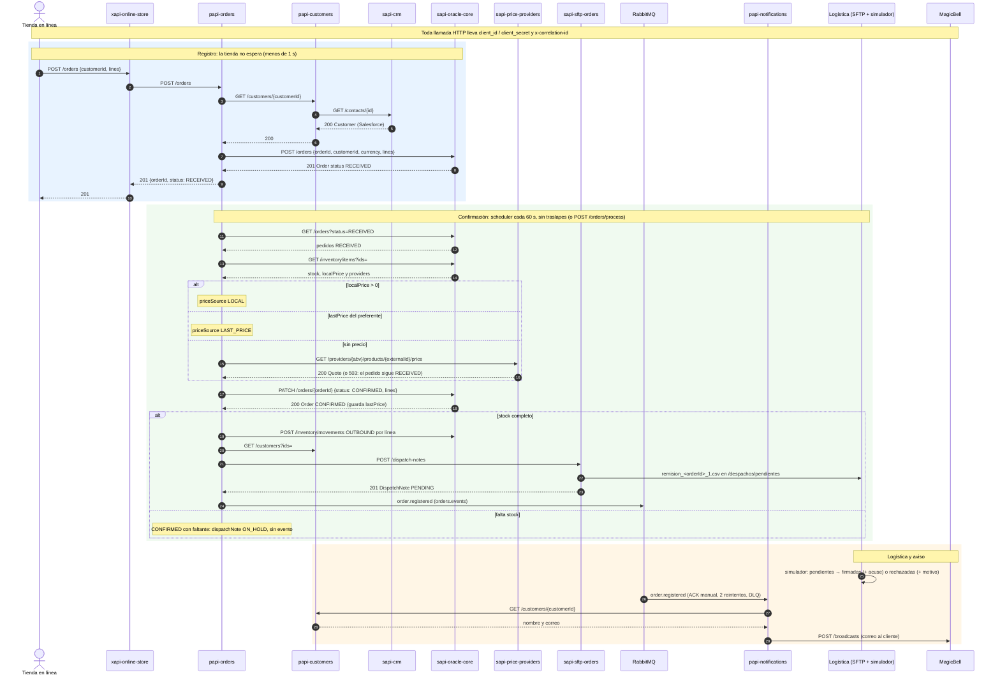
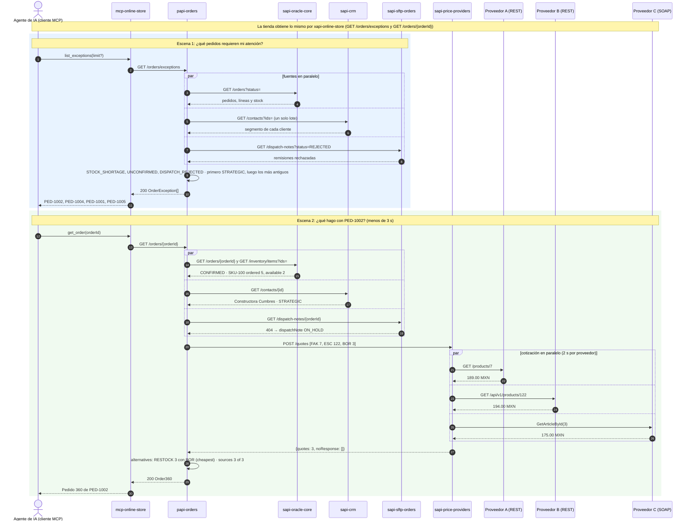
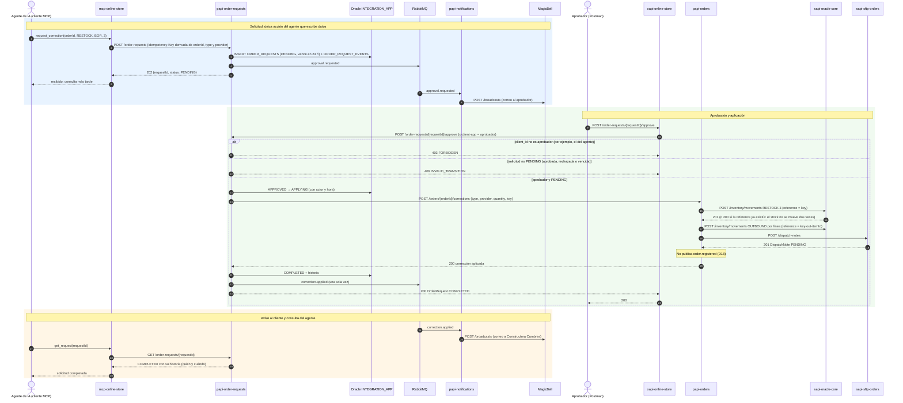

# Diagramas de secuencia de la PoC

Los cuatro recorridos de la sección II.2 de la final. La fuente de cada diagrama es su archivo `.mmd` en esta carpeta; este documento los reúne para verlos en GitHub o VS Code.

## 1. La vida de un pedido

Fuente: [`seq-1-vida-del-pedido.mmd`](seq-1-vida-del-pedido.mmd)



**Puntos clave**

- **Registro sin espera:** la tienda recibe `201 RECEIVED` en menos de 1 s; papi-orders solo valida al cliente en Salesforce (papi-customers → sapi-crm) y crea el pedido en el ERP.
- **Confirmación programada:** cada 60 s, sin traslapes, papi-orders toma los `RECEIVED` y fija el precio: `localPrice`, si no `lastPrice` del preferente, si no cotiza; si el proveedor no responde, el pedido sigue `RECEIVED`.
- **Stock completo:** salidas de inventario, remisión al SFTP y evento `order.registered`. **Falta stock:** queda `CONFIRMED` con la remisión `ON_HOLD` y sin evento (D8).
- **Logística y aviso:** el simulador firma o rechaza la remisión; papi-notifications consume el evento y envía el correo por MagicBell.

## 2. El Pedido 360 (escenas 1 y 2)

Fuente: [`seq-2-pedido-360.mmd`](seq-2-pedido-360.mmd)



**Puntos clave**

- **Escena 1:** `list_exceptions` consulta ERP, CRM y logística en paralelo, detecta `STOCK_SHORTAGE`, `UNCONFIRMED` y `DISPATCH_REJECTED`, y ordena primero a los clientes `STRATEGIC`.
- **Escena 2:** `get_order` arma el Pedido 360 de PED-1002 en menos de 3 s: pedido y stock del ERP, cliente de Salesforce, remisión de logística y cotización en paralelo de los tres proveedores.
- **Alternativa:** reponer 3 de SKU-100 con el proveedor C (175.00 MXN), marcada como la más barata; `sources.providers = "3 of 3"`.
- La tienda obtiene exactamente lo mismo por xapi-online-store.

## 3. Cuando algo falla (escena 3)

Fuente: [`seq-3-fallas.mmd`](seq-3-fallas.mmd)

```mermaid
sequenceDiagram
    autonumber
    actor A as Agente o tienda
    participant PO as papi-orders
    participant PP as sapi-price-providers
    participant PCs as Proveedor C (SOAP)
    participant SF as sapi-sftp-orders
    participant FS as SFTP
    participant POR as papi-order-requests

    rect rgb(255, 240, 240)
    Note over A,PCs: Tiempo límite: el proveedor C responde en 5 s (demo/control slow-c)
    A->>PO: GET /orders/{orderId}
    PO->>PP: POST /quotes [FAK, ESC, BOR]
    PP->>PCs: GetArticleById(3)
    Note over PP,PCs: Tiempo límite de 2 s. Sin reintento: solo se reintenta una falla de conexión (D9)
    PP-->>PO: {quotes: 2, noResponse: [BOR TIMEOUT]}
    PO-->>A: 200 Order360 · sources.providers = "2 of 3" (menos de 3 s)
    end

    rect rgb(255, 246, 230)
    Note over A,FS: Interruptor automático: el SFTP no responde (demo/control sftp-down)
    loop fallas 1 a 3
        PO->>SF: GET /dispatch-notes/{orderId}
        SF->>FS: conexión (3 s)
        FS--xSF: sin respuesta
        SF-->>PO: 503 retryable
    end
    Note over SF: 3 fallas seguidas: interruptor ABIERTO durante 30 s
    A->>PO: GET /orders/{orderId}
    PO->>SF: GET /dispatch-notes/{orderId}
    SF-->>PO: 503 inmediato, sin llamar al SFTP
    PO-->>A: 200 Order360 · dispatchNote.status = UNKNOWN · sources.logistics = UNAVAILABLE
    Note over SF,FS: A los 30 s, una llamada de prueba (semiabierto). Si responde, se cierra solo (demo/control sftp-up)
    end

    rect rgb(240, 250, 240)
    Note over A,POR: Llave única: el agente repite la solicitud de corrección
    A->>POR: POST /order-requests (Idempotency-Key k1)
    POR-->>A: 202 requestId R1
    A->>POR: POST /order-requests (Idempotency-Key k1)
    POR-->>A: 202 requestId R1 (la misma; no se crea otra)
    end
```

**Puntos clave**

- **Tiempo límite:** con el proveedor C a 5 s, la cotización corta a los 2 s y responde con dos de tres; C aparece en `noResponse` (sin reintento por tiempo agotado, D9).
- **Interruptor automático:** tras 3 fallas del SFTP se abre 30 s; las respuestas siguientes no esperan y el Pedido 360 muestra la remisión `UNKNOWN` con `sources.logistics = UNAVAILABLE`.
- **Recuperación:** al volver el SFTP, una llamada de prueba cierra el interruptor solo.
- **Llave única:** repetir la solicitud con la misma `Idempotency-Key` devuelve el mismo `requestId`.

## 4. Corrección con aprobación (escena 4)

Fuente: [`seq-4-correccion.mmd`](seq-4-correccion.mmd)



**Puntos clave**

- **El agente propone:** `request_correction` crea la solicitud `PENDING` (vence en 24 h), publica `approval.requested` y responde `202`; el aprobador recibe un correo.
- **Una persona decide:** solo la aplicación del aprobador puede aprobar (403 para el agente); aprobar algo que no está `PENDING` da 409.
- **Se aplica una sola vez:** papi-orders repone y descuenta con la misma llave como `reference`, y emite la remisión. No publica `order.registered` (D18).
- **Un solo aviso al cliente:** papi-order-requests termina en `COMPLETED` y publica `correction.applied` una vez; el cliente recibe un correo y el agente ve la historia completa.
